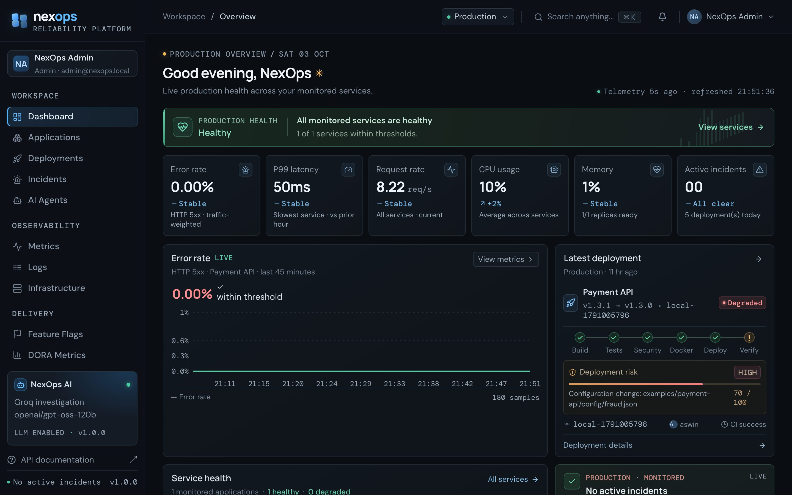
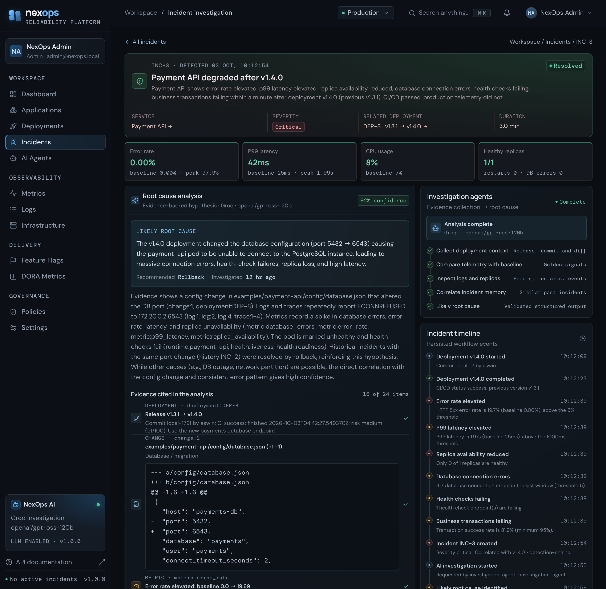
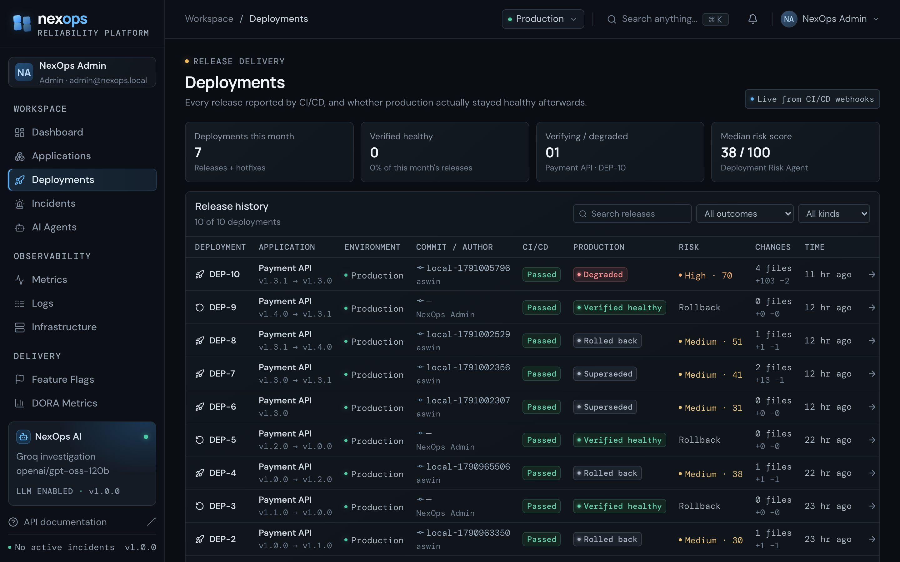
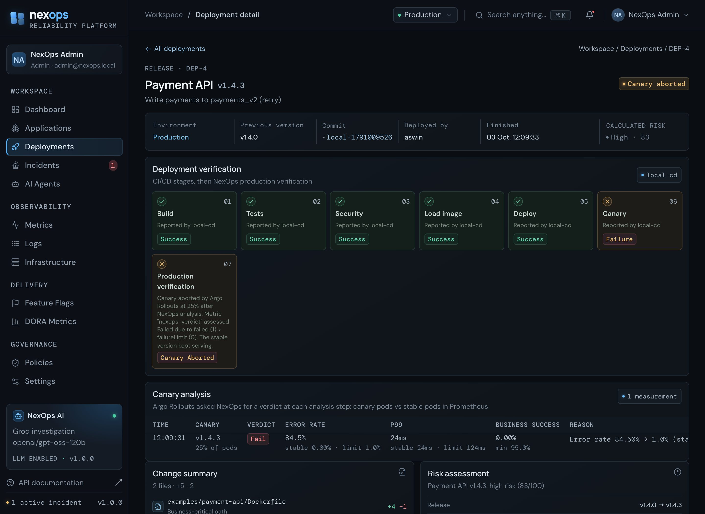
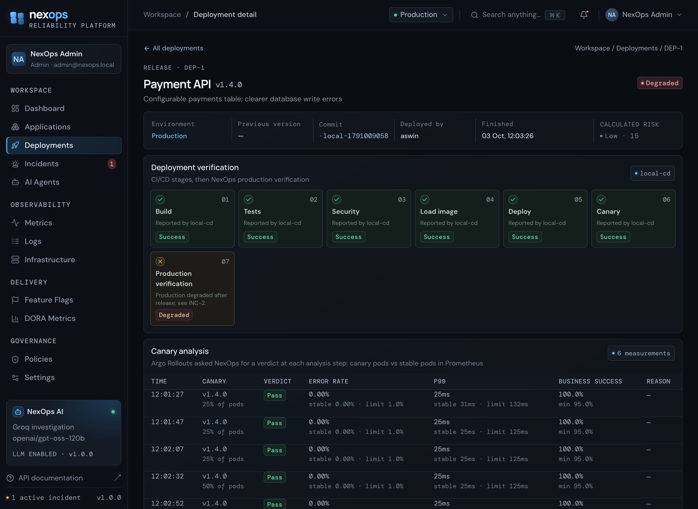
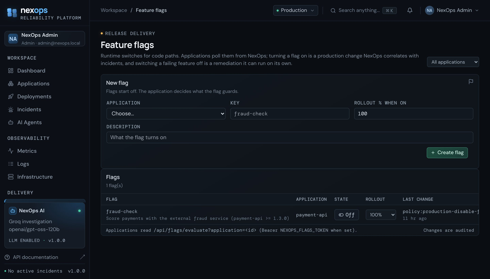
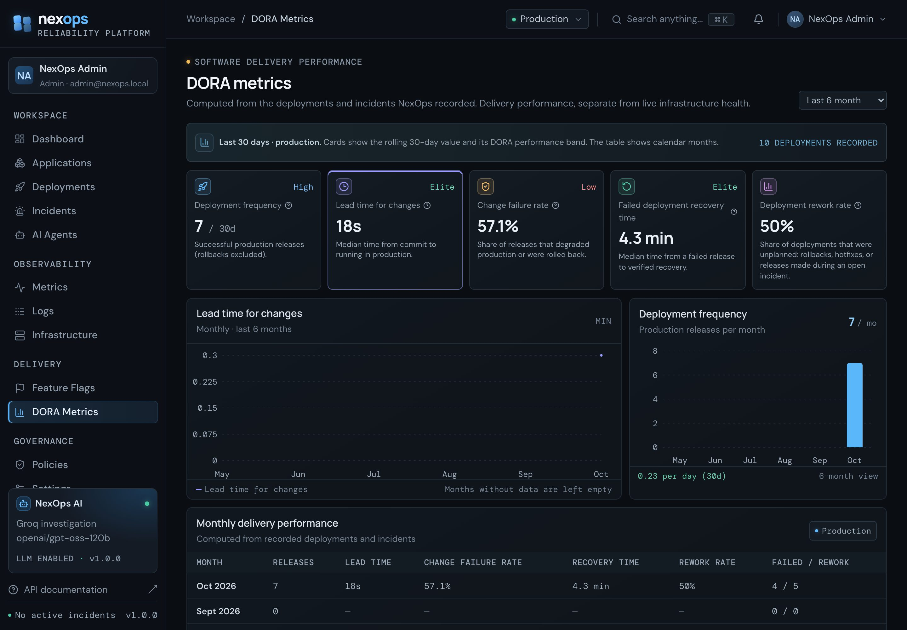
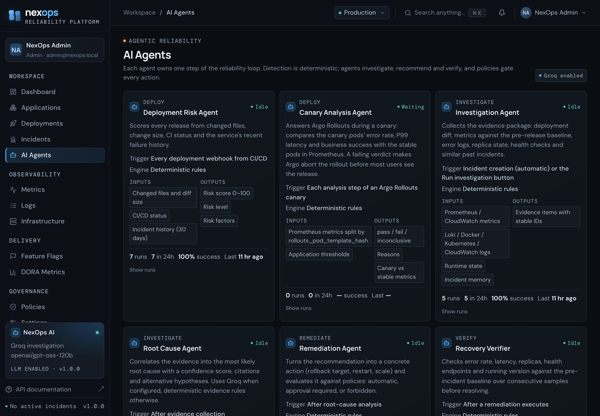
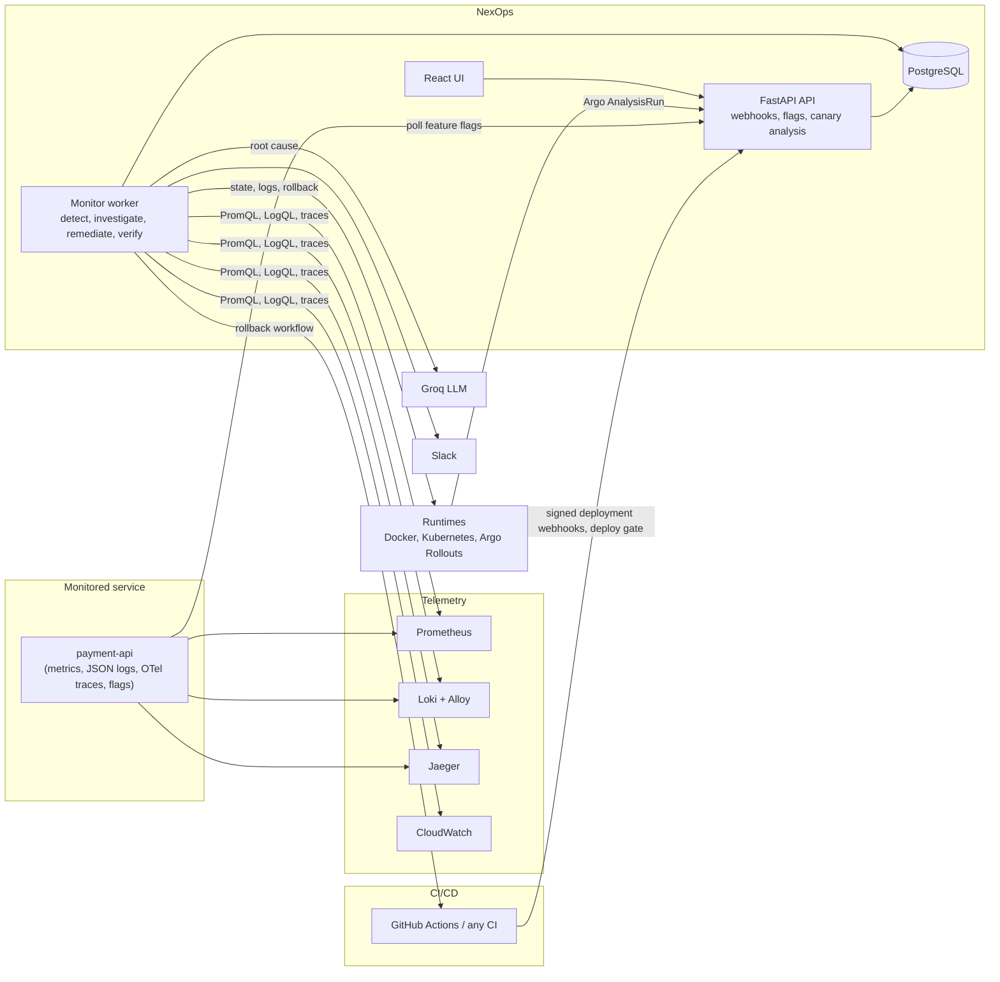

# NexOps

**An agentic deployment-reliability platform. CI/CD tells you a release passed its tests; NexOps tells you whether
production is actually healthy, finds out why when it is not, fixes it under your policies, and proves it recovered.**




```
Deploy → Monitor → Detect → Investigate → Remediate (policy + approval) → Verify recovery → Learn → DORA
```

Everything in the UI comes from real sources: CI/CD webhooks, Prometheus, Loki, Jaeger, the Docker Engine, the
Kubernetes API, AWS CloudWatch, HTTP health probes, GitHub and PostgreSQL. There is no mock data.

---

## The problem

A release can pass every test and still break production: a wrong config value, a missing migration, a slow
dependency, a feature switched on too early. The pipeline is green, customers get errors, and someone has to notice,
find the cause, decide what to do, fix it, and confirm that it is really fixed.

## What NexOps does

| Stage | What happens |
|---|---|
| **Deploy** | CI reports every release (version, commit, changed files, pipeline). NexOps scores its risk and can block deploys through a deploy gate. |
| **Monitor** | A worker collects golden signals, logs, traces, replica state and health checks every 15–30 s. |
| **Detect** | Deterministic rules compare production with the pre-release baseline; consecutive breaches open an incident, correlated with the release or the feature flag that caused it. |
| **Investigate** | Agents gather evidence (diff, metrics, error logs, failing traces, flag changes, similar past incidents) and an LLM (Groq, strict JSON schema) names the root cause with a confidence score and cited evidence. Without an LLM, an evidence-rules engine does the same job. |
| **Remediate** | Rollback, restart, scale up, pause deployments or **disable a feature flag**, each evaluated by policy: automatic, human approval, or forbidden. |
| **Verify** | The incident only resolves after consecutive healthy samples on error rate, latency, replicas, health checks and the running version. |
| **Learn** | A blameless postmortem, incident memory for future investigations, and DORA metrics computed from real records. |

## Screenshots

| Incident: AI root cause with cited evidence | Release history with risk and outcome |
|---|---|
|  |  |
| **Canary aborted: NexOps fails the 25% canary, Argo stops it** | **Canary promoted after six passing analyses** |
|  |  |
| **Feature flags NexOps can switch off on its own** | **DORA metrics from real deployments and incidents** |
|  |  |



## Highlights

- **Release-aware incident detection.** Breaches are compared with the pre-release baseline, require consecutive
  samples, honour a rollout grace period, and are attributed to the newest production change: a release *or* a
  feature flag switched on later (so a flag incident never counts against the release in DORA).
- **Evidence-backed AI root cause.** Every claim cites evidence IDs (`change:1`, `log:2`, `trace:3`…); the LLM runs
  with a strict JSON schema; a deterministic rules engine is the fallback.
- **Policy-gated remediation with real executors.** Docker container recreate, Kubernetes Deployment or Argo Rollout
  image change / restart / scale, GitHub Actions rollback workflow, deploy freeze, feature-flag switch-off.
- **Progressive delivery.** NexOps is the **analysis provider for Argo Rollouts**: each canary step asks NexOps for a
  verdict, and NexOps compares canary and stable pods by `rollouts_pod_template_hash` in Prometheus. A failing canary
  is aborted before most users see it; a live canary is never double-handled as an incident.
- **Distributed tracing as evidence.** OpenTelemetry → Jaeger; failing spans are grouped and linked from the incident.
- **Notifications** to Slack/Discord, sent only after the database change commits.
- **DORA metrics** (deployment frequency, lead time, change failure rate, recovery time) from recorded events.

Measured in end-to-end tests: a broken database config was detected, root-caused (92% confidence), rolled back after
approval and verified in about 3 minutes; a bad feature flag was switched off automatically and the incident resolved
in 105 s; a release with a missing migration was aborted at 25% after one NexOps canary check.

## Architecture



## Tech stack

| Area | Technology |
|---|---|
| Backend | Python 3.12, FastAPI, SQLAlchemy 2, Alembic, PostgreSQL, JWT auth with viewer / operator / admin roles |
| Monitor | a separate worker process with PostgreSQL advisory-lock leader election |
| Frontend | React 18, TypeScript, Vite, Tailwind, Recharts |
| Telemetry | Prometheus, Grafana Loki + Alloy, Jaeger v2 (OTLP), AWS CloudWatch |
| AI | Groq (OpenAI-compatible API, strict JSON schema output), deterministic evidence rules as fallback |
| Runtimes | Docker Engine SDK, Kubernetes Python client, Argo Rollouts |
| Infrastructure as code | Terraform (AWS: VPC, EC2, ECR, S3, SSM, IAM, GitHub OIDC; EKS with the AWS Load Balancer Controller, EBS CSI, IRSA, Helm) |
| Delivery | GitHub Actions pipelines (CI, platform deploy, service release with canary and rollback), Docker Compose, kind |

## Infrastructure and delivery

- **Local:** Docker Compose runs NexOps with the full observability stack and a sample service; `kind` runs the
  same on Kubernetes with Argo Rollouts canaries.
- **AWS (EC2):** Terraform builds a single-host deployment (VPC, EC2, ECR, CloudWatch, SSM secrets, S3 remote state,
  HTTPS via Caddy) that GitHub Actions deploys through OIDC (no stored AWS keys). `scripts/aws/hosted.py up / down`
  creates it on demand and removes everything afterwards, keeping the data in a local PostgreSQL in between: zero
  cloud cost between uses.
- **AWS (EKS):** an on-demand cluster with a Network Load Balancer on Elastic IPs, HTTPS without a domain, Argo
  Rollouts and the AWS Load Balancer Controller via Helm; `scripts/k8s/cluster.py eks-up / eks-down`.
- **Pipelines:** [`ci/github-actions/`](ci/github-actions): tests, migration checks, image builds, dependency scans,
  Terraform validation, deploys and rollbacks. In this showcase repository they are kept as code and are not active.

## Run it locally

Requirements: Docker Desktop and Python 3.10+.

```bash
git clone https://github.com/aswine2005/nexops.git && cd nexops
cp deploy/.env.example deploy/.env      # set the admin login and two random secrets (GROQ_API_KEY optional)
docker compose -f deploy/docker-compose.yml --env-file deploy/.env up -d --build
python3 scripts/register_local_app.py   # register the sample payment-api with its real telemetry sources
python3 scripts/deploy_local.py v1.0.0  # a healthy release, reported like CI would
```

Open http://localhost:8080 and sign in with the admin from `deploy/.env`. Then break a release on purpose:

```bash
python3 scripts/deploy_local.py v1.1.0 --break-db-config
```

The pipeline passes, production fails. Within a minute NexOps opens an incident tied to v1.1.0, cites the config
diff and the "connection refused" logs, and proposes a rollback for your approval; it then executes it, verifies
recovery and writes the postmortem. More scenarios (feature flag, canary on kind, online) are in
[docs/TESTING.md](docs/TESTING.md).

## Repository layout

| Path | What |
|---|---|
| [`backend/`](backend) | FastAPI API, monitor worker, detection, investigation, remediation, migrations, tests |
| [`src/`](src) | React UI |
| [`examples/`](examples) | instrumented sample service (payment-api) and a traffic generator |
| [`deploy/`](deploy) | Docker Compose stack, Prometheus/Loki/Alloy/Grafana/Jaeger config, EC2 compose files, Kubernetes manifests (`k8s/`) |
| [`infra/terraform/`](infra/terraform) | AWS (EC2 stack) and EKS stacks |
| [`scripts/`](scripts) | local CD, registration, `aws/hosted.py` (up/down), `k8s/cluster.py` (kind/EKS) |
| [`ci/github-actions/`](ci/github-actions) | CI/CD pipelines (inactive in this repository) |
| [`docs/`](docs) | guides |

## Documentation

- [Run it locally](docs/RUN_LOCAL.md) and [run it on AWS](docs/RUN_ONLINE.md)
- [User manual](docs/USER_MANUAL.md): every page and feature
- [Testing guide](docs/TESTING.md): break releases on purpose and watch NexOps handle them; connect your own service
- [Kubernetes and Argo Rollouts](docs/KUBERNETES.md)
- [Environment variables](docs/ENVIRONMENT.md), [AWS resources and costs](docs/AWS_RESOURCES.md), [build phases](docs/SETUP.md)

## Author

**Aswin E**: [github.com/aswine2005](https://github.com/aswine2005)
